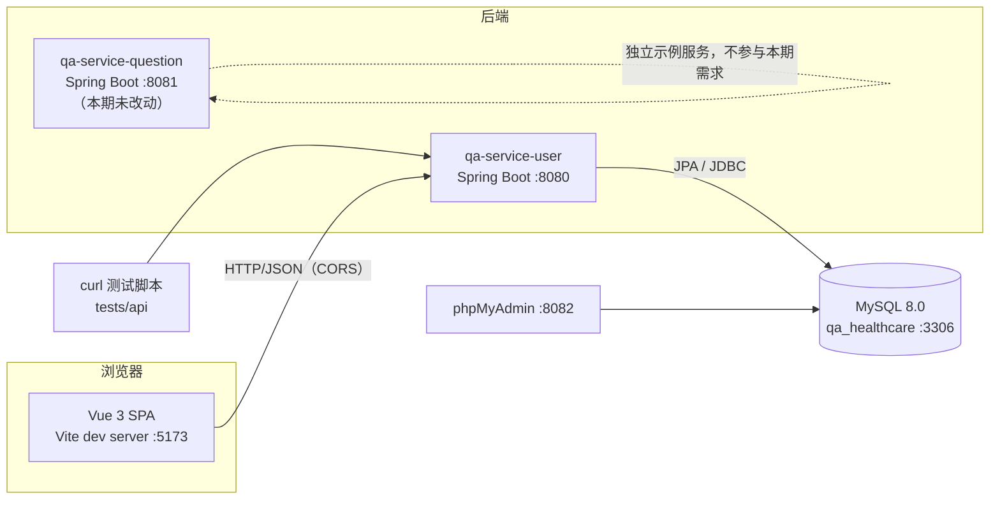
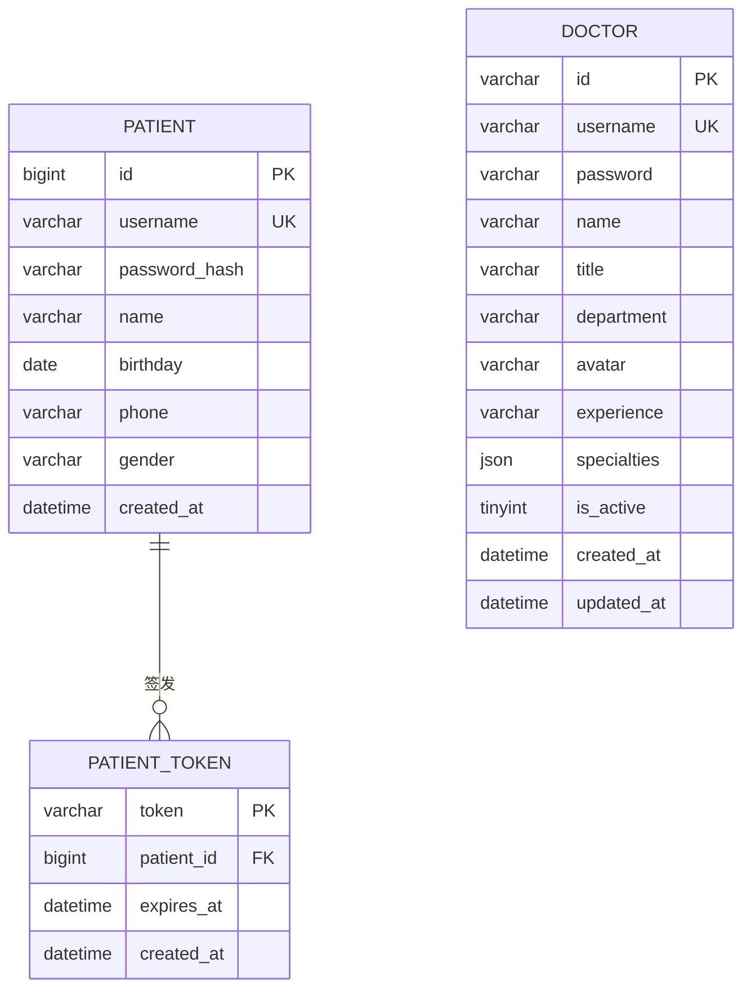
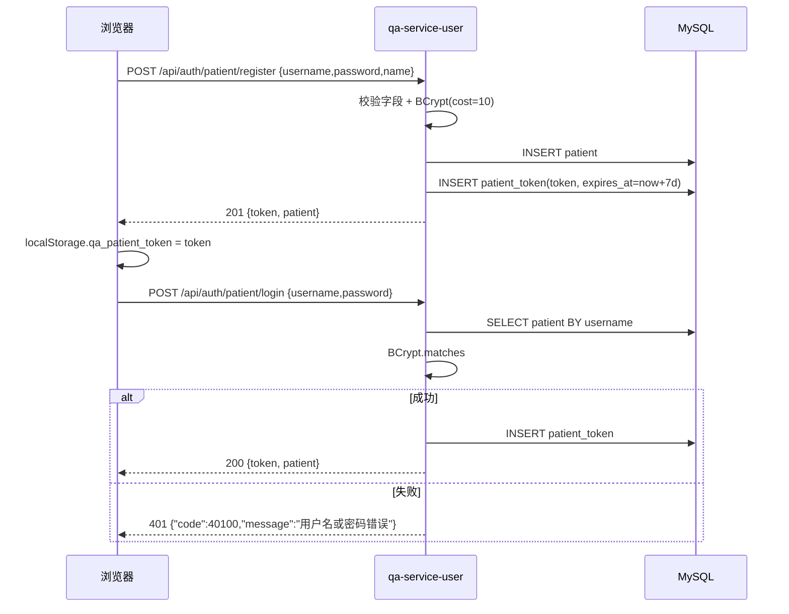
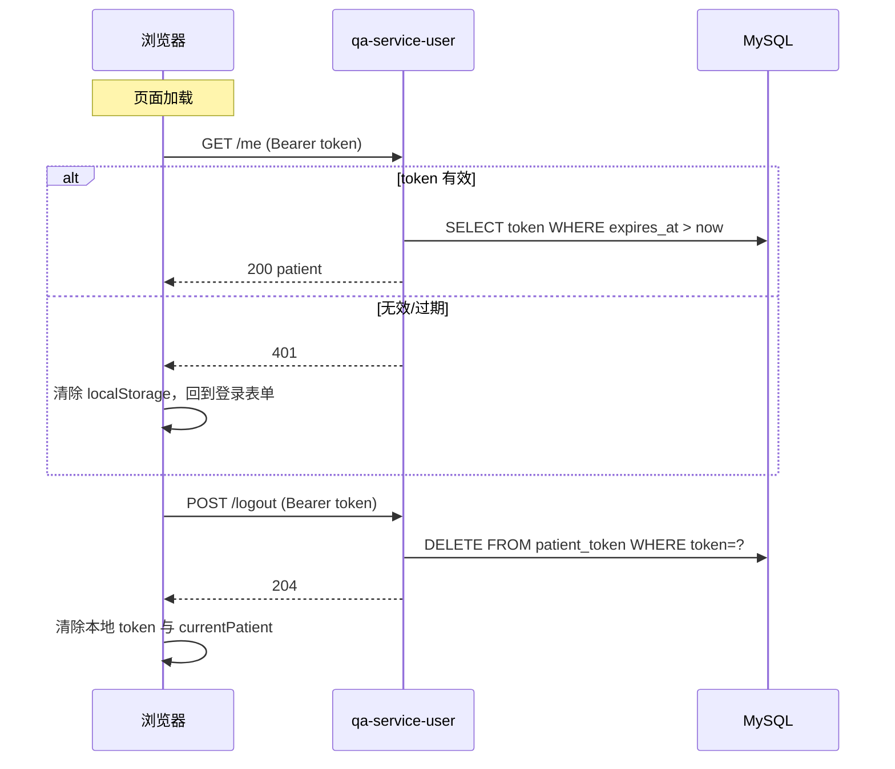

# 设计说明（DESIGN.md）

> 目标读者：面试评审 / 后续维护者
> 关联文档：[README](../README.md)、[执行计划](EXECUTION_PLAN.md)、[PRD 模板](PRD_TEMPLATE.md)、[患者登录 PRD](PRD-patient-login.md)、[测试报告](TEST_REPORT.md)
> 代码基线：`feature-interview-1021`

---

## 1. 概览

### 1.1 三项需求与设计目标

| 需求 | 设计目标 |
|---|---|
| 1. 首页中英切换 | 不引入重型方案；外壳 + 首页全部文案可切换；刷新保持 |
| 2. 医生数据从 MySQL 读取 | 数据与代码解耦；一条命令起库；改库后页面即时变化可演示 |
| 3. 患者用户名密码登录 | 密码安全存储；登录态可保持/可退出；接口可被 curl 复现 |

整体原则：**最小依赖、可本地一键复现、每个结论都有命令/证据**。

### 1.2 技术栈

| 层 | 选型 | 版本 |
|---|---|---|
| 前端 | Vue 3 + TypeScript + Vite | 3.5 / 5.6 / 5.4.8 |
| UI | ant-design-vue | 4.2.6 |
| 路由 | vue-router | 4.6.3 |
| 国际化 | vue-i18n | 11.4.16 |
| 后端 | Spring Boot（Java 17） | 3.5.7 |
| 持久化 | Spring Data JPA + MySQL Connector/J | Boot 管理版本 |
| 数据库 | MySQL（Docker） | 8.0.46 |
| 密码 | spring-security-crypto（BCrypt） | Boot 管理版本 |
| 测试 | curl + PowerShell / bash | 系统自带 |

---

## 2. 总体架构



### 2.1 请求链路（文本版）

```text
浏览器(5173)
  └─ fetch /api/**
       └─ qa-service-user(8080)   [CORS 放行 5173]
            └─ DoctorController / PatientAuthController
                 └─ Service（业务校验/BCrypt/Token）
                      └─ Repository（Spring Data JPA）
                           └─ MySQL(3306) / qa_healthcare
```

### 2.2 端口与环境

| 组件 | 端口 | 说明 |
|---|---|---|
| 前端 Vite | 5173 | 开发服务器，直连 8080（无代理） |
| qa-service-user | 8080 | 本期全部业务接口 |
| qa-service-question | 8081 | 初始项目示例服务，未改动 |
| MySQL | 3306 | 容器 `qa-mysql`，库 `qa_healthcare` |
| phpMyAdmin | 8082 | 演示"改库"用 |
| Actuator | 8080 | `/actuator/health` |

---

## 3. 模块职责

### 3.1 前端 `web/qa-web/src`

| 目录/文件 | 职责 |
|---|---|
| `api/http.ts` | fetch 封装：统一响应体解析、业务码判断、`204` 处理、`ApiError` |
| `api/doctors.ts` | 医生列表 / 医生登录 |
| `api/auth.ts` | 患者注册 / 登录 / me / 登出；token 读写 |
| `store/index.ts` | 轻量响应式 store：医生缓存与加载态、患者登录态、问题（内存） |
| `views/Home.vue` | 首页：统计/诊室来自 API；错误提示 + 重试 |
| `views/Doctors.vue` | 医生列表：loading / 错误 / 重试；进入诊室 |
| `views/Consultation.vue` | 患者登录/注册 Tab、问诊门户、提交问题（内存） |
| `views/DoctorLogin.vue` / `DoctorRoom.vue` | 医生登录与诊室（沿用，登录改走 API） |
| `i18n/index.ts` + `locales/*` | 语言状态、`localStorage.qa_locale`、`<html lang>` |
| `components/AppHeader.vue` / `AppFooter.vue` | 外壳文案国际化 + 语言切换入口 |

### 3.2 后端 `server/qa-service-user`

| 包 | 职责 |
|---|---|
| `controller` | `DoctorController`、`PatientAuthController`、示例 `TestController` |
| `service` | `DoctorService`（列表/登录）、`PatientAuthService`（注册/登录/me/登出） |
| `repository` | `DoctorRepository`、`PatientRepository`、`PatientTokenRepository` |
| `entity` | `Doctor`（JSON 转换器）、`Patient`、`PatientToken` |
| `dto` | 所有对外响应对象（**均不含密码字段**） |
| `common` | `ApiResponse<T>` 统一响应体 |
| `exception` | `ApiException` + `GlobalExceptionHandler`（400/401/409/500） |
| `config` | `CorsConfig` |

### 3.3 其他

| 路径 | 职责 |
|---|---|
| `deploy/mysql/init/01_schema.sql` | 建库建表（utf8mb4） |
| `deploy/mysql/init/02_seed_doctors.sql` | 5 位医生种子 |
| `deploy/mysql/init/03_seed_patient.sql` | 演示患者（BCrypt） |
| `tests/api/*` | curl 接口测试与一键脚本 |
| `docs/test-evidence/*` | 测试证据（日志/响应，token 脱敏） |

---

## 4. 数据模型



### 4.1 `doctor`

| 字段 | 类型 | 约束 | 说明 |
|---|---|---|---|
| `id` | varchar(32) | PK | 如 `doc001` |
| `username` | varchar(64) | UNIQUE | 医生登录名 |
| `password` | varchar(100) | NOT NULL | **演示用明文密码**（接口不返回；见 10.1 风险） |
| `name/title/department` | varchar(64) | NOT NULL | 姓名/职称/科室 |
| `avatar` | varchar(512) | 默认 `''` | 头像 URL |
| `experience` | varchar(128) | 默认 `''` | 从业经验 |
| `specialties` | **json** | NOT NULL | 擅长领域数组，如 `["高血压","冠心病"]` |
| `is_active` | tinyint(1) | 默认 1，索引 | 是否在诊 |
| `created_at/updated_at` | datetime | 默认/自动更新 | 审计字段 |

### 4.2 `patient`

| 字段 | 类型 | 约束 | 说明 |
|---|---|---|---|
| `id` | bigint unsigned | PK AUTO_INCREMENT | — |
| `username` | varchar(64) | UNIQUE | 4–32 位字母/数字/`_`/`-`（服务层校验） |
| `password_hash` | varchar(100) | NOT NULL | **BCrypt**（cost=10） |
| `name` | varchar(64) | NOT NULL | 姓名 |
| `birthday/phone/gender` | date/varchar | 可空 | 资料 |
| `created_at` | datetime | 默认当前时间 | — |

### 4.3 `patient_token`

| 字段 | 类型 | 约束 | 说明 |
|---|---|---|---|
| `token` | varchar(64) | PK | 32 字节随机数的 Base64URL（43 字符） |
| `patient_id` | bigint unsigned | FK → patient，`ON DELETE CASCADE` | 所属患者 |
| `expires_at` | datetime | NOT NULL | 签发后 7 天 |
| `created_at` | datetime | 默认当前时间 | — |

> 字符集统一 `utf8mb4 / utf8mb4_unicode_ci`；初始化脚本显式 `SET NAMES utf8mb4`，避免中文双重编码。

---

## 5. 接口设计

### 5.1 统一约定

```json
{"code":0,"message":"ok","data":...}
```

| code | 含义 | HTTP |
|---|---|---|
| `0` | 成功 | 200 / 201 |
| `40000` | 参数或请求体错误 | 400 |
| `40100` | 未登录 / 登录失效 / 用户名或密码错误 | 401 |
| `40900` | 用户名已存在 | 409 |
| `50000` | 服务端内部错误（不泄露堆栈） | 500 |

### 5.2 医生

| 方法 | 路径 | 入参 | 出参 `data` | 错误 |
|---|---|---|---|---|
| GET | `/api/doctors` | query `active?`（boolean） | `DoctorDto[]` | 400 参数格式错误；500 |
| POST | `/api/doctors/login` | `{username, password}` | `DoctorDto` | 401 `用户名或密码错误` |

`DoctorDto`：`id, username, name, title, department, avatar, experience, specialties[], isActive`（**无 password**）。

### 5.3 患者认证

| 方法 | 路径 | 入参 | 出参 `data` | 错误 |
|---|---|---|---|---|
| POST | `/api/auth/patient/register` | `{username,password,name,birthday?,phone?,gender?}` | `{token, patient}`（201） | 400 参数；409 重复；500 |
| POST | `/api/auth/patient/login` | `{username,password}` | `{token, patient}` | 400 空值；401 统一失败；500 |
| GET | `/api/auth/patient/me` | Header `Authorization: Bearer <token>` | `patient` | 401 未登录/失效；500 |
| POST | `/api/auth/patient/logout` | Header 同上 | 空（204） | 无（幂等） |

`patient`：`id, username, name, birthday, phone, gender`（**无 password_hash**）。

---

## 6. 登录时序

### 6.1 注册/登录



### 6.2 会话恢复与登出



---

## 7. 关键决策记录

### 7.1 医生数据从 JSON 迁移到 MySQL

- **背景**：README 要求医生数据入库；前端原用 `doctor-user-list.json`。
- **决策**：MySQL 8.0 + init SQL；前端只保留 API 数据源。
- **理由**：可演示"改库 → 刷新即变"；数据与发布解耦；为后续分页/检索留空间。
- **代价**：本地必须起 Docker；多一层网络与 ORM；种子与表结构需维护。
- **替代**：继续用 JSON（无法满足需求 2）。

### 7.2 `specialties` 用 JSON 列

- **决策**：`specialties json` + `SpecialtiesJsonConverter`（List<String> ↔ JSON 字符串）。
- **理由**：演示项目读多写少；避免额外关联表与 join；MySQL 8 原生 JSON。
- **代价**：无法对单个擅长领域建索引/关联查询；复杂检索需改表。
- **替代**：`doctor_specialty` 关联表（更规范，但本期过度设计）。

### 7.3 患者密码 BCrypt

- **决策**：`BCryptPasswordEncoder(10)`，只存哈希。
- **理由**：加盐、慢哈希，抗彩虹表；Spring Security 自带，无额外依赖。
- **代价**：单次登录有约几十毫秒 CPU 开销；无法"找回原密码"（只能重置）。
- **替代**：MD5/SHA（不安全，拒绝）；Argon2（需额外依赖）。

### 7.4 不透明 token（而非 JWT）

- **决策**：32 字节随机数 → Base64URL（43 字符），存 `patient_token`，7 天过期。
- **理由**：可**服务端即时撤销**（登出删除即失效）；实现简单，无签名密钥管理；演示友好。
- **代价**：每次 `/me` 查库；水平扩展需共享存储；token 泄露窗口内可被重放。
- **替代**：JWT（无状态但撤销复杂）；HttpOnly Cookie（更安全，需改前端存储与 CORS 凭据）。

### 7.5 统一响应体 + 业务码

- **决策**：`{code,message,data}`；HTTP 状态码与业务码同时表达语义。
- **理由**：前端统一处理；错误可预期；测试断言稳定。
- **代价**：多一层包装；需维护码表。

### 7.6 医生登录改走数据库

- **背景**：删除医生 JSON 后，原前端明文密码校验失效。
- **决策**：新增 `POST /api/doctors/login`，服务端比对 `doctor.password`。
- **理由**：保持医生端可用；密码不再下发前端。
- **代价**：医生密码仍是**明文**存储（演示数据，见 10.1）。
- **替代**：医生密码也改 BCrypt（更安全，需迁移种子与登录逻辑）。

### 7.7 前端统一数据源

- **决策**：`store.loadDoctors()` 唯一入口，Home 与 Doctors 共用；含 loading/error/retry。
- **理由**：避免两处数据不一致；删除 JSON 后无第二来源。
- **代价**：首屏需等待 API；需要错误态设计。

### 7.8 i18n 范围限定

- **决策**：只覆盖 **Header/Footer + 首页正文**；其他页面正文保持中文。
- **理由**：README 需求 1 的范围；控制改动面与回归成本。
- **代价**：其他页面中英混排（已知限制）。
- **实现**：`vue-i18n` + `localStorage.qa_locale` + `<html lang>`；语言入口全站可见。

### 7.9 问题数据保留在前端内存

- **决策**：不新增问题表/接口，沿用 `question-list.json` + 内存操作。
- **理由**：README 只要求医生数据入库；控制范围。
- **代价**：刷新丢失；无法多端同步（已知限制）。

### 7.10 `ddl-auto=none` + init SQL

- **决策**：表结构由 `deploy/mysql/init/*.sql` 管理，应用不自动建表。
- **理由**：结构可 review、可版本化；避免 Hibernate 对 JSON 列的校验问题。
- **代价**：改表需改 SQL 并重建库（演示项目可接受）。
- **替代**：Flyway/Liquibase（更规范，本期未引入）。

---

## 8. 与代码一致性抽查

| # | 设计点 | 代码位置 | 验证方式 |
|---|---|---|---|
| 1 | 医生响应不含密码 | `dto/DoctorDto.java` 仅 9 个字段；`DoctorDto.from` 不映射 `password` | `curl /api/doctors` 响应无 `"password"` |
| 2 | 患者 BCrypt + 7 天 token | `service/PatientAuthService.java`：`new BCryptPasswordEncoder(10)`、`plusDays(7)`、`SecureRandom` 32 字节 | DB `password_hash` 以 `$2a$` 开头；登录 token 长度 43 |
| 3 | specialties JSON 映射 | `entity/SpecialtiesJsonConverter.java` + `Doctor.specialties` | `/api/doctors` 返回数组；DB 列为 `json` |
| 4 | 前端单一医生数据源 | `store/index.ts` 的 `loadDoctors()`；`api/doctors.ts` | 删除 `doctor-user-list.json` 后页面仍展示 5 位医生 |
| 5 | i18n 范围与持久化 | `i18n/index.ts` 的 `setLocale()` 写 `qa_locale`；Header/Footer/Home 使用 `$t` | 切英文刷新后 Header/Footer/首页仍为英文 |

---

## 9. 可扩展性

| 方向 | 建议 |
|---|---|
| 医生检索/分页 | `Pageable` + `department/is_active` 索引；或独立检索服务 |
| 擅长领域检索 | 迁移到关联表或 MySQL 8 多值索引 |
| 会话安全 | token 改 HttpOnly Cookie + CSRF；增加 refresh token 轮换 |
| 防暴力破解 | 登录失败计数、验证码、IP 限流（Redis） |
| 问题持久化 | 新增 `question` 表与接口；前端移除内存实现 |
| 迁移管理 | 引入 Flyway，替代手工 init SQL |
| 可观测 | 结构化日志、指标、链路追踪；Actuator 已开 health/metrics |
| 多环境 | 配置外置（环境变量/Profile），CORS 白名单化 |
| API 演进 | 增加 `/api/v1` 前缀与版本策略 |

---

## 10. 已知限制与风险

### 10.1 安全

| 项 | 说明 | 影响 |
|---|---|---|
| 医生密码明文 | `doctor.password` 为演示明文（需求 2 未要求加密） | 仅本地演示可接受；生产必须改 BCrypt |
| token 存 localStorage | XSS 可窃取（PRD R1） | 中风险；可改 HttpOnly Cookie |
| 无登录限流/验证码 | 可被暴力尝试 | 中风险；后续加限流 |
| CORS 全放行 | `allowedOriginPatterns("*")` + credentials | 仅开发环境；生产需白名单 |
| 演示账号提交在仓库 | `demo_patient/123456` | 仅演示；生产禁用/改密 |

### 10.2 功能

| 项 | 说明 |
|---|---|
| 问题数据不落库 | 刷新丢失，无法多端同步 |
| 无分页/搜索 | 医生列表全量返回（当前 5 条） |
| 无找回/修改密码 | 超出本期范围 |
| 无 token 主动清理任务 | 过期 token 惰性失效，未定期清理 |
| 其他页面未国际化 | 范围约定，仅外壳 + 首页 |
| 单实例 | token 存 DB，水平扩展需共享存储/缓存 |

---

## 11. 运行与配置

```powershell
# 1) 数据库（首次或重置）
docker compose up -d

# 2) 后端（JDK 17）
$env:JAVA_HOME = 'D:\dev\jdk17'
cd server\qa-service-user
.\mvnw.cmd -s D:\dev\maven-settings.xml spring-boot:run

# 3) 前端
cd web\qa-web
npm run dev
```

关键配置：

| 配置 | 值 | 位置 |
|---|---|---|
| 端口 | 8080 | `application.properties` |
| 数据源 | `jdbc:mysql://localhost:3306/qa_healthcare?...` | 同上 |
| JPA | `ddl-auto=none`、`open-in-view=false` | 同上 |
| 前端 API 地址 | `VITE_API_BASE_URL=http://localhost:8080` | `web/qa-web/.env.development` |
| 演示账号 | `demo_patient / 123456` | `03_seed_patient.sql` |

---

## 12. 需求 → 实现映射

| 需求 | 关键实现 | 验收证据 |
|---|---|---|
| 1. 首页中英切换 | `i18n/*`、Header/Footer/Home | T03/T04 回归；T14 首页切换回归 |
| 2. 医生数据 MySQL + API | `docker-compose.yml`、init SQL、`/api/doctors`、前端 API 层 | T09 改库刷新；T17 测试报告 DOC-01~05 |
| 3. 患者登录 | `PatientAuthService`、`/api/auth/patient/*`、`Consultation.vue` | T14 全流程/隔离；T17 AUTH-01~14 |
| 交付物 | 计划/PRD/测试/提示词/设计/视频脚本 | `docs/*` |
